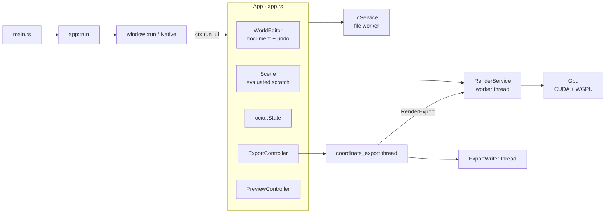
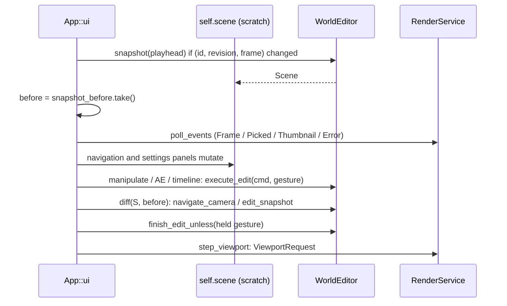
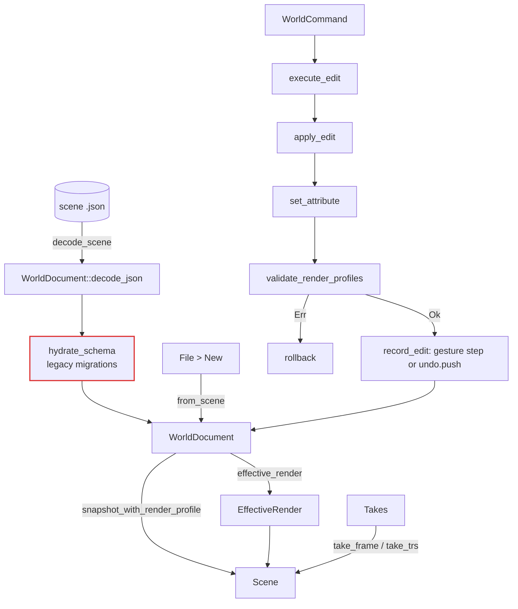
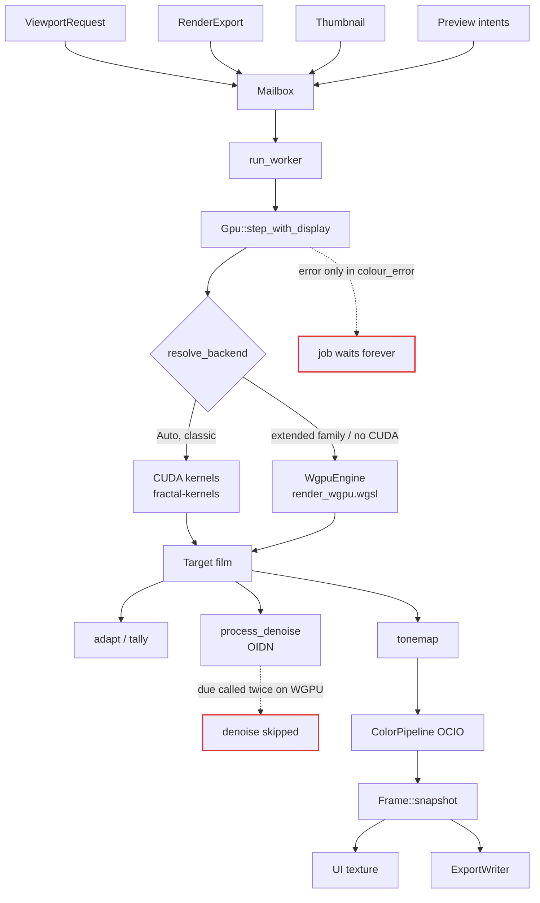
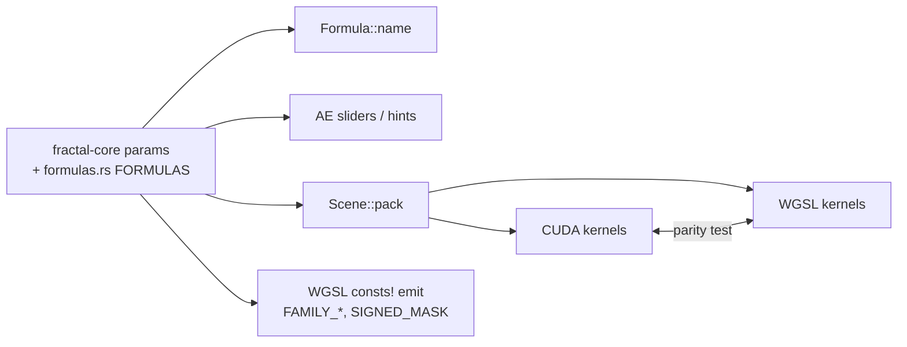
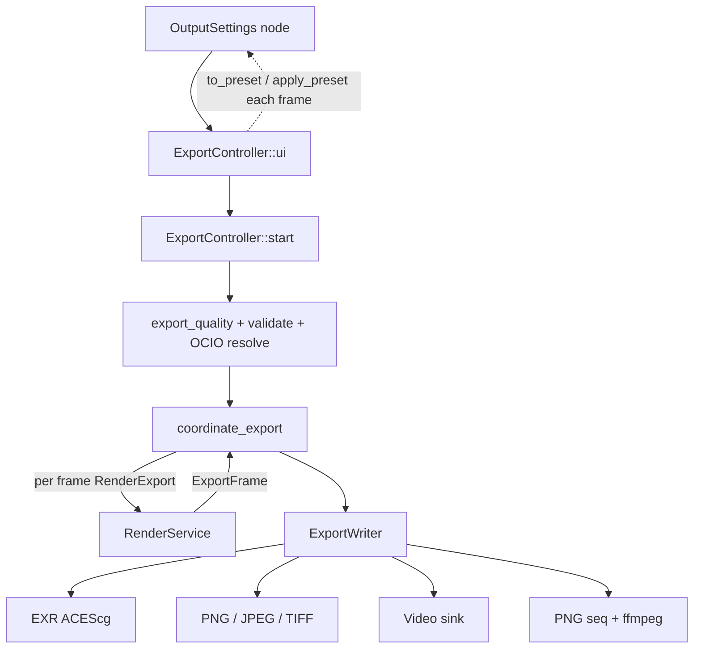

# WarpBro diagrams

Mermaid views of the main dataflows. ASCII versions with line anchors: [AGENTS.md](AGENTS.md).
As of commit `4cfa5eb` (2026-10-22). Red edges mark the defects tracked in [plan1.md](plan1.md).

## Ownership

## Per-frame edit transaction

## World document

## Render worker

## Formula registry (target state after plan1.md)

## Export

