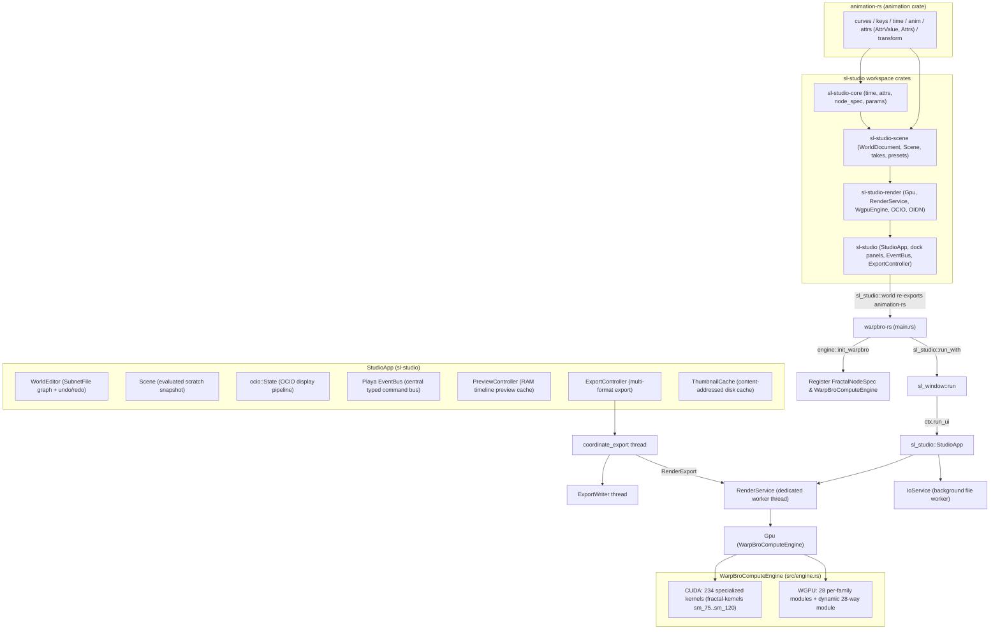
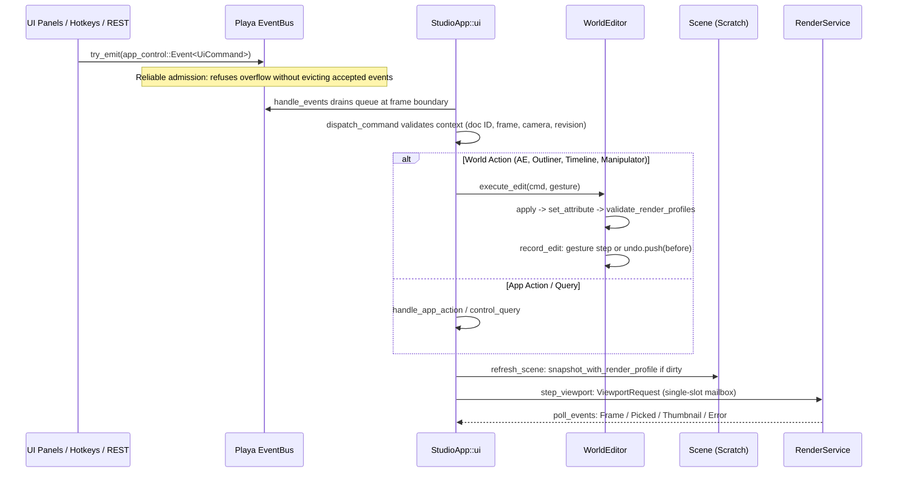
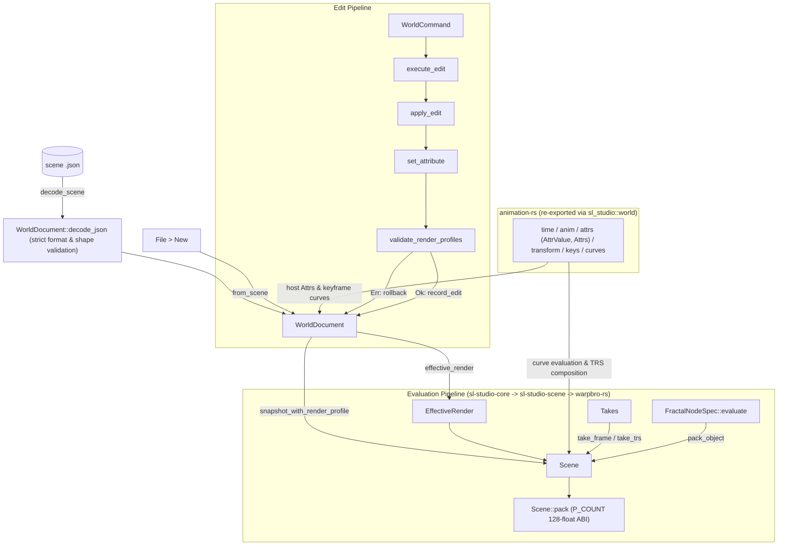
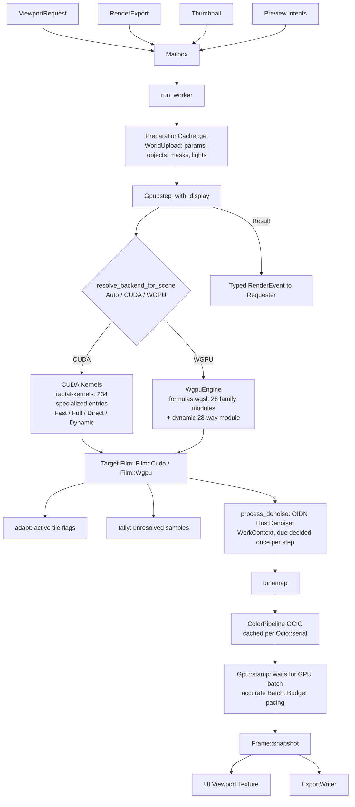
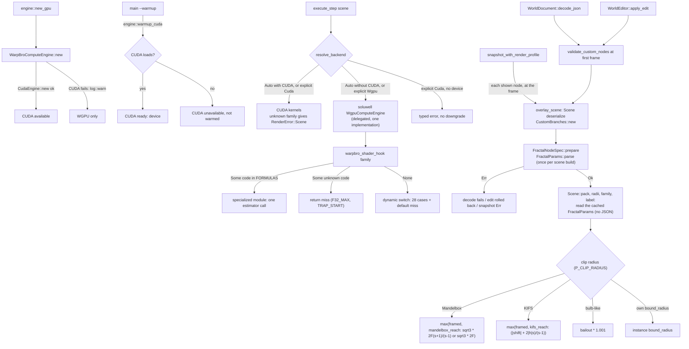
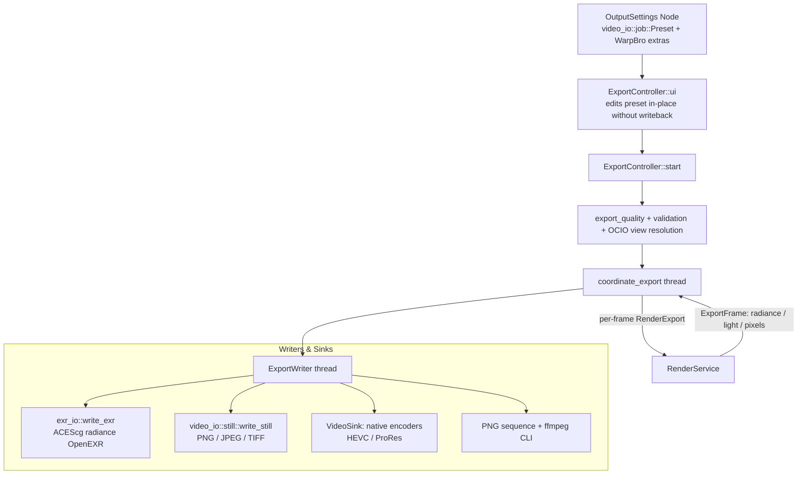

# WarpBro diagrams

Mermaid views of the main system dataflows, reflecting the `sl-studio` architecture (`5afff8a`).
Companion architecture notebooks: [PLAN.md](PLAN.md) and [AGENTS.md](AGENTS.md).

---

## 1. Ownership & Crate Dependency Architecture



---

## 2. Per-Frame Edit Transaction & Playa EventBus



---

## 3. World Document & Scene Evaluation



---

## 4. Render Worker & Dual Compute Backends



---

## 5. Formula Registry & Compute Engine ABI

```mermaid
flowchart LR
  subgraph SSOT[Single Source of Truth]
    params[fractal-core::params]
    reg[formulas.rs: FORMULAS [FormulaMeta; 28]]
  end

  SSOT --> form[Formula: 28-variant enum]
  SSOT --> ui[Attribute Editor<br/>ParamMeta sliders, tooltips, validation]
  SSOT --> pack[FractalNodeSpec::pack_object<br/>P_COUNT 128-float ABI]
  SSOT --> consts["engine.rs warpbro_shader_hook<br/>SIGNED_MASK, ITERATING_MASK + family_distance switch"]

  pack --> cuda[CUDA: fractal-kernels<br/>234 specialized kernel entries]
  consts --> wgsl[WGPU: formulas.wgsl<br/>28 distance estimators]

  cuda <-->|parity_tests.rs| wgsl
  subgraph Parity[Parity Verification]
    num[Numerical DE / trap / guide oracle]
    img[Rendered image pixel comparison]
  end
  parity -.-> num
  parity -.-> img
```

---

## 6. Backend Resolution, Shader Hook, Fractal Validation & Clip (after plan1 waves A-D)

Real codepaths in `src/engine.rs` / `src/fractal_node.rs` and soluwell `world.rs`
(egui-widgets-rs `13d6f8d`). See [plan1.md](plan1.md) for why each path is shaped this way.



---

## 7. Multi-Threaded Export Pipeline


