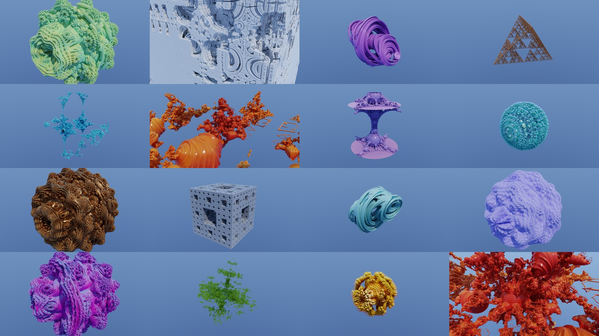

# Fractals and Procedural Shapes

WarpBro provides **28 distance-estimated 3D fractal and procedural geometry families** (`0..28`), unified under a declarative metadata architecture in [`src/formulas.rs`](../src/formulas.rs) and [`src/formulas.wgsl`](../src/formulas.wgsl).

Every family supports:
- **Spherical inversion** (`/inversion_strength`, `/inversion_radius`, `/inversion_center`) with exact conformal stretch compensation.
- **14 colour palettes** and **4 colouring modes** (`Radius`, `TrapOrigin`, `TrapPlane`, `TrapPoint`).
- **World transforms, masks, and arrays** (sphere, box, and 3D cellular masks; linear and radial arrays up to 32 instances).
- **Full path tracing & Direct shading** with Autodesk Standard Surface (coat, sheen, thin-film iridescence, anisotropy, dielectric transmission with Beer–Lambert absorption).
- **Full timeline animation** of every numeric, vector, integer, and discrete enum parameter, with automatic greying (`inactive_reason`) of parameters unused in the current mode.

---

## Declarative Metadata Architecture (`src/formulas.rs`)

Each of the 28 families is described in `FORMULAS: [FormulaMeta; 28]` (`src/formulas.rs`):
- **`FormulaMeta`**: family code (`0..28`), serde variant key, UI display name, hover tooltip, whether the family uses the shared Julia/orbit constant (`has_orbit_constant`), whether it runs an iteration loop (`uses_iterations()`), and its slice of `ParamMeta` descriptors.
- **`ParamMeta`**: attribute field name, human-readable label, hover hint, hard validation range `(min, max)`, soft interactive slider span `(min, max)`, discrete enum choices, and Attribute Editor sort order.
- **Per-object GPU slot block (`P_BULB_POWER..P_LIGHT_DIR`, slots `39..70`)**: all 20 extended families pack their parameters into the 32 per-object formula `f32` slots without increasing `OBJECT_STRIDE` (`188` floats) or `N_PARAMS`.

---

## Classic Fractal Families (`0..8`)

| Code | Family | Orbit Constant | Signed DE | Description |
| ---: | :--- | :---: | :---: | :--- |
| `0` | **Mandelbulb** | Yes | Unsigned | Spherical triplex power fractal ($z \mapsto z^p + c$) with fast algebraic power-8 path, angle scale/phase, and per-iteration rotation. |
| `1` | **Mandelbox** | Yes | Unsigned | Tglad's conformal box-fold + sphere-fold fractal with negative/positive scale and per-iteration rotation. |
| `2` | **Quaternion Julia** | No | Unsigned | 3D hyperplane slice ($w = \text{slice\_w}$) of a 4D quaternion quadratic Julia set ($q \mapsto q^2 + c$) with 4D rotation. |
| `3` | **KIFS** | No | Signed | Kaleidoscopic IFS with polyhedral reflection planes (`Tetrahedron`, `Octahedron`, `Menger`). |
| `4` | **Kleinian** | No | Signed | Maskit-slice Kleinian group limit set via periodic box wrapping and unit-sphere inversion. |
| `5` | **Pseudo-Kleinian** | No | Signed | Knighty's Mandelbox–Kleinian limit set with cylindrical Thingy distance estimator. |
| `6` | **Apollonian** | No | Unsigned | 3D Apollonian sphere-packing foam via periodic lattice folding and conformal sphere inversion. |
| `7` | **Hybrid** | No | Unsigned | 4-slot alternating operator sequence combining `Mandelbulb`, `Mandelbox`, `KifsFold`, and `Inversion` steps. |

---

## Extended 3D Escape-Time & IFS Fractals (`8..16`)

### 8. Amazing Surface (`AmazingSurface` / KaliBox)
Kali's surface variation of the Mandelbox with independent per-axis box-fold limits (`fold_limit = [fx, fy, fz]`; set `fz = 0` to disable Z folding for planar Kali-surface ruins), a pre-sphere translation shift (`shift`), sphere inversion (`min_radius`, `fixed_radius`), conformal `scale`, and per-iteration rotation. Supports Julia morphing and orbit offset.

### 9. Bristorbrot (`Bristorbrot`)
Bristor's quadratic 3D hypercomplex fractal:
$$
(x, y, z) \mapsto \left(x^2 - y^2 - z^2,\; y(2x + s_y z),\; z(2x + s_z y)\right)\cdot \text{scale} + c
$$
with independent cross-term signs (`y_sign`, `z_sign`), helical X-axis `twist`, `bailout`, and per-iteration Euler rotation. Produces intricate coral-like dendritic filaments.

### 10. Burning Ship 3D (`BurningShip`)
3D Burning Ship / Mandelbulb-Abs fractal that blends each coordinate toward its absolute value (`mix(z, abs(z), abs_axes) + shift`) before spherical triplex exponentiation (`power`).

### 11. Kaleido Twist IFS (`KaleidoTwist` / Marble Marcher)
The Marble Marcher / Menger-Twist IFS combining abs folding, pre-rotation (`rotation_degrees`), Menger coordinate sorting ($x \ge y \ge z$), anisotropic shift (`shift`), half-space Z clamping (`clamp_z`), and a second inter-step rotation (`post_rotation_degrees`).

### 12. Polyhedral KIFS (`PolyhedralKifs`)
Knighty's golden-ratio reflection group IFS supporting full **Icosahedral** ($I_h$, 120-fold) and **Dodecahedral** symmetry (`symmetry`), vertex `offset`, `scale`, `shell_thickness`, and per-iteration rotation.

### 13. Harmonic Bulb (`HarmonicBulb`)
Spherical-harmonics modulated Mandelbulb where radial growth is perturbed by real spherical harmonics $Y_l^m(\theta, \phi) = \cos(l\theta)\cos(m\phi)$ controlled by latitude degree `harmonic_l`, longitude order `harmonic_m`, and `amplitude`.

### 14. Mandelbar 3D (`Mandelbar3D` / Tricorn)
3D Tricorn / Mandelbar fractal applying complex conjugation across azimuthal (`conjugate_xy`) and polar (`conjugate_z`) angles during triplex exponentiation, plus azimuthal `twist`.

### 15. Möbius Sphere IFS (`MobiusIfs`)
Conformal 3D Möbius group limit set combining helical `twist`, 3D periodic lattice wrapping (`lattice_pitch`), and clamped sphere inversion (`min_radius`, `fixed_radius`, `scale`).

---

## Triply Periodic Minimal Surfaces & Chaotic Flows (`16..19`)

### 16. Gyroid / Schwarz TPMS (`GyroidTpms`)
Analytical Triply Periodic Minimal Surfaces supporting four classic topologies (`surface`):
- **Gyroid**: $\sin x \cos y + \sin y \cos z + \sin z \cos x = \text{bias}$
- **Schwarz P**: $\cos x + \cos y + \cos z = \text{bias}$
- **Schwarz D (Diamond)**: $\sin x \sin y \sin z + \sin x \cos y \cos z + \cos x \sin y \cos z + \cos x \cos y \sin z = \text{bias}$
- **Neovius**: $3(\cos x + \cos y + \cos z) + 4\cos x \cos y \cos z = \text{bias}$

Includes multi-octave FBM fractal detailing (`octaves` $1\dots 6$, `lacunarity`, `gain`), `frequency`, `thickness`, and helical `twist`.

### 17. Lidinoid / Fischer–Koch TPMS (`LidinoidTpms`)
Higher-order chiral minimal surfaces (`Lidinoid`, `FischerKochS`, `SplitP`) with double-gyroid channels, `harmonic_mix`, `radial_warp`, `frequency`, `thickness`, and `bias`.

### 18. Strange Attractor Flow (`AttractorTube`)
3D chaotic strange-attractor stream-ribbons (`Aizawa`, `Halvorsen`, `Thomas`) advected via 2nd-order Runge–Kutta integration (`step_dt`, `swirl`, `param_a`, `param_b`, `tube_radius`) over `/render/iterations` steps.

---

## Knots, Fiber Bundles, & Differential Geometry (`19..23`)

### 19. Torus Knot Braid (`TorusKnotBraid`)
Exact $(p, q)$ torus knot (`winds_p`, `winds_q`, `major_radius`, `minor_radius`, `tube_radius`) with $N$-strand twisted cable braiding (`sub_strands`, `braid_depth`).

### 20. Hopf Fibration Tori (`HopfFibration`)
Stereographic projection of the $S^3 \to S^2$ Hopf fibration into $\mathbb{R}^3$, forming linked Villarceau circles arranged across concentric Clifford torus shells (`fibers`, `shells`, `latitude`, `tube_radius`, `twist`, `scale`).

### 21. Dupin Cyclide (`DupinCyclide`)
Quartic Dupin cyclide (inversion of a torus) with exact gradient normalization:
$$
F(x, y, z) = (x^2 + y^2 + z^2 + b^2 - d^2)^2 - 4(ax - cd)^2 - 4b^2 y^2 = 0
$$
Controlled by `major_a`, `minor_b`, `eccentricity_c`, `radius_d`, `shell_thickness`, and curvature-aligned fluting (`rib_frequency`, `rib_depth`).

### 22. 3D Superformula / Radiolaria (`Superformula3D`)
3D spherical product of Gielis superformulas $r(\theta, \phi) = r_1(\phi)\,r_2(\theta)$ with independent longitudinal (`m1`, `n1_1`, `n2_1`, `n3_1`) and latitudinal (`m2`, `n1_2`, `n2_2`, `n3_2`) exponents, hollow `shell_thickness`, and Haeckel radiolaria skeletal pores (`pore_frequency`).

---

## Biological, Cellular, Mineral, & Mechanical Shapes (`23..28`)

### 23. Fibonacci Phyllotaxis / Romanesco (`PhyllotaxisShell`)
Closed-form $O(1)$ inverse spherical Fibonacci lattice (Keinert et al.) placing `count` golden-angle spiral florets ($12\dots 600$) on a core sphere (`base_radius`), each sculpted with conical Romanesco buds (`cone_height`, `cone_sharpness`, `sub_florets`, `spiral_twist`).

### 24. Nautilus / Ammonite Shell (`NautilusShell`)
Raup's logarithmic helicospiral shell ($r(\theta) = r_0 e^{b\theta}$) with configurable `expansion_rate`, `coil_tightness`, conispiral `spire_translation`, `wall_thickness`, `turns`, external ammonite corrugation (`rib_frequency`, `rib_amplitude`), and internal chamber septa visible in cutaway or refractive glass renders.

### 25. Voronoi Trabecular Foam (`VoronoiFoam`)
Multi-scale 3D Voronoi cell-wall / trabecular bone skeleton (`cell_density`, `strut_radius`, `jitter`, hierarchical `octaves` $1\dots 3$, `lacunarity`, and inner `shell_hollow`).

### 26. Quartz Crystal Cluster / Geode (`CrystalGeode`)
Procedural mineral crystal cluster radiating `crystal_count` ($1\dots 24$) hexagonal quartz prisms (`prism_length`, `prism_radius`) with 6-sided rhombohedral pyramid terminations (`tip_slope`), golden-angle `cluster_spread`, and optional hollow `geode_cavity`.

### 27. Mechanical Astrolabe / Gimbal (`AstrolabeGimbal`)
Concentric nested gyroscopic gimbal rings (`ring_count` $1\dots 8$, `outer_radius`, `ring_spacing`, `ring_width`, `ring_thickness`) with incremental Euler inclination and precession (`tilt_step_degrees`, `spin_degrees`), precision `gear_teeth` (`tooth_depth`), and carved sight-holes around a central sun sphere.

---

## Raymarching & Normal Stencil Optimizations

WarpBro's raymarcher (`src/render_wgpu.wgsl`) includes several algorithmic optimizations that preserve surface hits while accelerating primary, bounce, shadow, and AO rays:
1. **Multi-object ray–sphere union span culling (`march_span`)**: in world scenes where all objects have finite clip spheres, rays intersect every object's bounding sphere up front to restrict marching to the union interval $[t_{\min}, t_{\max}]$ and immediately reject rays that miss all objects.
2. **Cached local coordinates & min-reach-first ordering (`march_sample`)**: per-step object-local coordinates `q`, `len_q`, and sphere reach `(len_q - clip_r) * dist_scale` are computed once and cached; the object with minimal reach is evaluated first so its distance estimate prunes remaining objects.
3. **4-probe tetrahedral finite-difference normals**: `stencil_normal` and `direct_normal` evaluate a symmetric 4-point regular tetrahedron stencil `[1,-1,-1], [-1,-1,1], [-1,1,-1], [1,1,1]` with step scaling $h/\sqrt{3}$, cutting DE evaluations per surface normal from 6 to 4 (a 33% reduction in normal cost).
